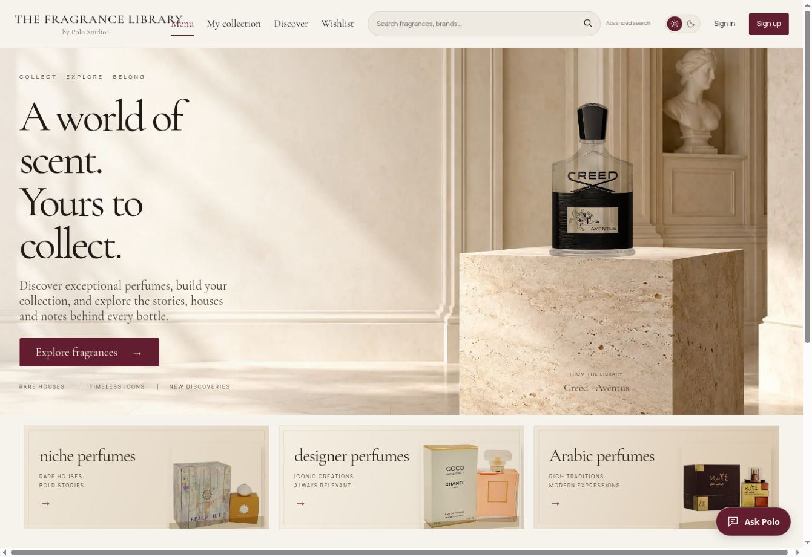

# Fragrance Library

**A live beta for discovering fragrances, building a collection, and estimating its replacement value.**  
A Polo Studios project by **Miguel A. De Jesus**.

[Open the app](https://pologram1.github.io/fragrance-library/) · [Portfolio](https://pologram1.github.io/POLO-TECH/projects.html#fragrance) · [Report an issue](https://github.com/pologram1/fragrance-library/issues)

[](https://github.com/pologram1/fragrance-library/actions/workflows/validate.yml)



## What it does

Fragrance Library connects fragrance discovery with collection tracking. Visitors can search a shared catalog, save bottles to a collection or wishlist, record remaining volume, and see estimates based on matching seller offers.

- Browse **niche perfumes**, **designer perfumes**, and **Arabic perfumes**, with brand filters and optional advanced search.
- Explore fragrance notes and sourced profiles, with direct seller links.
- Add exact bottle variants directly to the selected collection or wishlist.
- Track remaining mL, quantity-adjusted replacement value, observed market movement, and consumption value.
- Use browser storage as a guest or username/password accounts backed by Supabase for private cross-device saving.
- Switch between light and dark themes.

## How valuation works

An offer must match the bottle identity, concentration, size, and bottle type. Eligible offers are in-stock USD listings from reviewed sellers, checked within the configured freshness window. Each seller hostname contributes once; the arithmetic average gives the reference bottle price.

Remaining value scales that price by quantity and remaining volume. Missing prices stay unknown, and partial coverage is shown rather than treating unknown bottles as free. These are **replacement-cost estimates**, not resale appraisals or guaranteed purchase quotes. Tax and shipping are excluded. See [pricing rules](docs/market-prices.md) and [value tracking](docs/value-tracking.md).

## Architecture

| Layer | Files | Responsibility |
| --- | --- | --- |
| Interface | `index.html`, `app.js`, `home.js`, `theme.js`, CSS files | Discovery, collection views, profiles, and presentation. |
| Domain rules | `pricing.js`, `market-prices.js`, `portfolio.js`, `catalog.js` | Exact bottle matching, eligible offers, search, and valuation. |
| Accounts | `auth.js`, `username-auth.js`, `cloud-store.js`, `backend/` | Supabase authentication, account isolation, validated saves, and SQL setup. |
| Data | `data/`, `runtime-data.js`, `scripts/build_runtime.js` | Shared source records and compact browser runtime data. |
| Ingestion | `scripts/` | Reproducible catalog, photo, seller, and note processing. |
| Automation | `.github/workflows/` | Validation, scheduled data refresh, and Pages publication. |

The browser reads public catalog/price data and saves private collection changes through Supabase. Guest data remains on the device. Source ingestion and review are separate from private user collections.

## Run locally

```sh
git clone https://github.com/pologram1/fragrance-library.git
cd fragrance-library
node scripts/build_runtime.js
python3 -m http.server 8000
```

Open `http://localhost:8000`. Use Node.js 22 for tests and runtime-data generation. The frontend has no package installation step. The account features depend on the configured Supabase project; see [accounts](docs/accounts.md) before deploying a separate instance. Keep privileged keys out of frontend configuration.

## Validation

```sh
node --test ./*.test.js
python3 -m pip install -r scripts/photo_requirements.txt
python3 scripts/refresh_prices.test.py
python3 scripts/enrich_catalog.test.py
python3 scripts/import_seller_feed.test.py
```

Tests exercise account isolation/save ordering, exact seller matching, freshness, category search, direct-add destinations, duplicates, remaining-volume valuation, runtime data, themes, and photo approval. GitHub Actions runs these checks on pushes and pull requests. Photo-processing tests have additional dependencies listed in `scripts/photo_requirements.txt`.

## Contribution

**Miguel A. De Jesus — Polo Studios:** application concept, collection and discovery workflows, interface iteration, valuation requirements, and product development. The repository includes frontend implementation, backend setup, data pipelines, and automated checks. Public catalog data, retailer material, and product imagery are attributed separately; see [data licensing](data/LICENSE.md) and the source/review documentation.

## Status and limitations

**Live beta · Active development.** Seller data is checked snapshots, not a continuous live price feed. Coverage is incomplete, and scheduled refreshes may skip unavailable sources. Photo publication requires identity/quality review. Direct shopping links currently do not earn affiliate revenue. Google sign-in and email recovery are not enabled. Recognition of bottle usage is not automatic: remaining volume is recorded by the user.

## Further reading and next steps

[Catalog](docs/catalog.md) · [Accounts](docs/accounts.md) · [Retailer enrichment](docs/retailer-enrichment.md) · [Photo standards](docs/photo-standard.md) · [Discovery profiles](docs/fragrance-discovery.md) · [Automation](docs/automation.md)

Next steps: expand reliable exact-variant coverage, improve reviewed imagery, and add an account-recovery flow before broader use. Affiliate integrations remain a future product decision.

[Contact Miguel](mailto:themiguel10101@gmail.com) · [Polo Studios](https://pologram1.github.io/POLO-TECH/)
